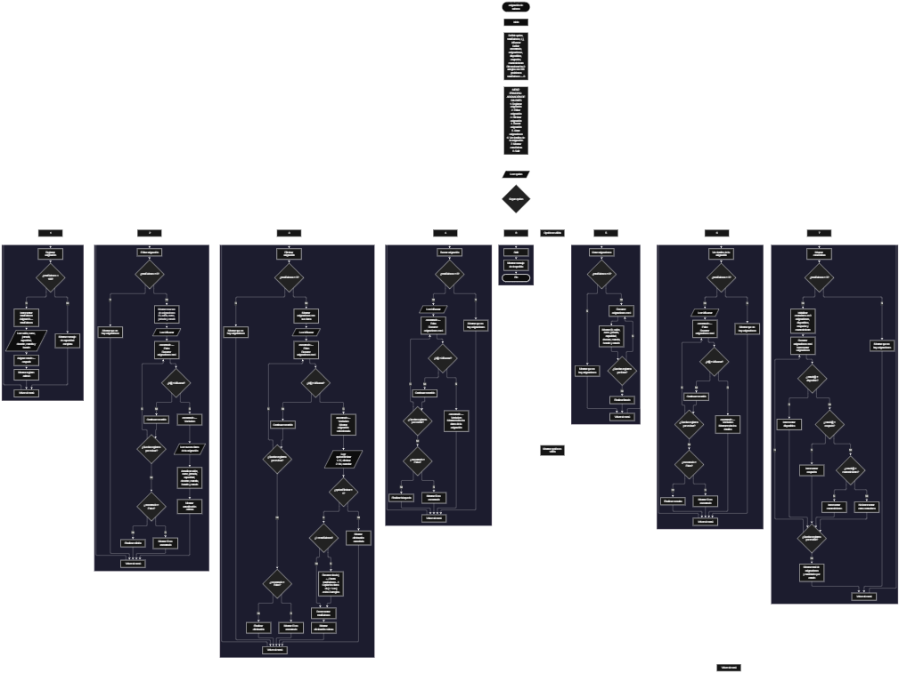

 

Este proyecto, llamado <b>asignación de salones</b>, fue desarrollado en <b>pseint</b> como un ejercicio práctico para fortalecer la lógica de programación mediante la creación de un sistema de gestión de asignaciones académicas desde la consola. El programa cuenta con un menú principal de ocho opciones que permite <b>registrar, editar, eliminar, buscar, listar, consultar los detalles y mostrar estadísticas</b> de las asignaciones de salones. Cada asignación almacena información como el nombre del salón, el curso o grado, la jornada, la capacidad, el docente, la materia, el horario y el estado. Para organizar estos datos, se utilizan nueve arreglos paralelos con una capacidad máxima de <b>100 asignaciones durante la ejecución</b>. Durante su desarrollo se aplicaron conceptos fundamentales de programación, como variables, arreglos, estructuras condicionales, ciclos repetitivos y estructuras de selección, además de procesos para buscar, modificar, eliminar y reorganizar registros. Este proyecto permite poner en práctica los conocimientos adquiridos en PSeInt y sirve como base para desarrollar sistemas de gestión académica más avanzados utilizando otros lenguajes y tecnologías.

<h2 align="center">⚙️ Funcionamiento del menú principal</h2>

### ➕ Registrar asignación

La opción <b>1) registrar asignación</b> permite almacenar una nueva asignación de salón. Antes de realizar el registro, el sistema comprueba que la cantidad de asignaciones sea menor que <b>100</b>, utilizando la condición <b>totalSalones &lt; 100</b>. Si existe espacio disponible, la variable <b>totalSalones</b> aumenta en uno y el programa asigna un identificador mediante la instrucción <b>id[totalSalones] &lt;- totalSalones</b>. Después, solicita el <b>nombre del salón, curso o grado, jornada, capacidad, docente, materia y horario</b>. Los datos se almacenan en la posición correspondiente de sus respectivos arreglos y el estado se establece automáticamente como <b>"ocupado"</b>. Finalmente, muestra el mensaje <b>"asignacion registrada correctamente."</b>. Si se alcanza la capacidad máxima, presenta el mensaje <b>"no hay espacio para registrar mas asignaciones."</b>, impidiendo registrar otra asignación.

### ✏️ Editar asignación

La opción <b>2) editar asignación</b> permite modificar los datos de una asignación registrada. Primero, el programa comprueba si existen registros mediante la variable <b>totalSalones</b>. Si no hay asignaciones almacenadas, muestra el mensaje <b>"no hay asignaciones registradas."</b>. En caso contrario, presenta una lista resumida con el identificador, el nombre del salón, el curso, la jornada y el estado de cada registro. Después, solicita el identificador de la asignación que se desea editar y utiliza la variable <b>idBuscar</b> para localizarla mediante un ciclo <b>para</b>. Cuando encuentra una coincidencia, establece <b>encontrado</b> en <b>verdadero</b> y solicita la nueva información del salón, curso, jornada, capacidad, docente, materia, horario y estado. Los datos se actualizan directamente en sus respectivos arreglos. Finalmente, muestra el mensaje <b>"asignacion editada correctamente."</b>. Si el identificador no coincide con ningún registro, presenta el mensaje <b>"no se encontro una asignacion con ese id."</b>.

### 🗑️ Eliminar asignación

La opción <b>3) eliminar asignación</b> permite eliminar una asignación mediante su identificador. Antes de comenzar, el programa comprueba si existen registros. Si no hay asignaciones, muestra el mensaje <b>"no hay asignaciones registradas."</b>. Si existen registros, presenta la información completa de cada asignación, incluyendo el identificador, el salón, el curso, la jornada, la capacidad, el docente, la materia, el horario y el estado. Después, solicita el identificador que se desea eliminar y utiliza la variable <b>encontrado</b> para determinar si existe una coincidencia. Cuando localiza el registro, muestra nuevamente sus datos y solicita confirmación mediante las opciones <b>1) sí</b> y <b>2) no</b>. Si el usuario confirma la eliminación, el programa utiliza un ciclo <b>para</b>, controlado por la variable <b>j</b>, para desplazar una posición hacia la izquierda los datos posteriores en los nueve arreglos: <b>id, salon, curso, jornada, capacidad, docente, materia, horario y estado</b>. Posteriormente, disminuye la variable <b>totalSalones</b> en uno y muestra el mensaje <b>"asignacion eliminada correctamente."</b>. Si el usuario cancela, presenta el mensaje <b>"eliminacion cancelada."</b>. Si no encuentra el identificador solicitado, muestra el mensaje <b>"no se encontro una asignacion con ese id."</b>.

### 🔎 Buscar asignación

La opción <b>4) buscar asignación</b> permite localizar una asignación mediante su identificador. Primero, el programa comprueba si existen registros. Si no hay asignaciones almacenadas, muestra el mensaje <b>"no hay asignaciones registradas."</b>. En caso contrario, solicita el identificador que se desea buscar y establece la variable lógica <b>encontrado</b> en <b>falso</b>. A continuación, utiliza un ciclo <b>para</b> para recorrer las asignaciones registradas y comparar cada identificador mediante la condición <b>id[i] = idBuscar</b>. Cuando encuentra una coincidencia, cambia <b>encontrado</b> a <b>verdadero</b> y muestra todos los datos de la asignación: identificador, salón, curso, jornada, capacidad, docente, materia, horario y estado. Si termina el recorrido sin encontrar coincidencias, presenta el mensaje <b>"no se encontro una asignacion con ese id."</b>. La búsqueda utiliza el identificador almacenado en el arreglo <b>id</b> para localizar el registro correspondiente.

### 📋 Listar asignaciones

La opción <b>5) listar asignaciones</b> permite visualizar todas las asignaciones registradas actualmente. Antes de mostrar la información, el programa comprueba si la variable <b>totalSalones</b> es igual a <b>0</b>. Si no existen registros, presenta el mensaje <b>"no hay asignaciones registradas."</b>. Si hay asignaciones disponibles, utiliza un ciclo <b>para</b> para recorrer los arreglos desde la primera posición hasta el total de registros almacenados. Durante el recorrido, muestra el identificador, el nombre del salón, el curso, la jornada, la capacidad, el docente, la materia, el horario y el estado de cada asignación. Esta función facilita consultar los registros existentes sin necesidad de buscar individualmente cada asignación.

### 📄 Ver detalles de la asignación

La opción <b>6) ver detalles de la asignación</b> permite consultar la información completa de una asignación específica. Primero, el programa verifica si existen registros. Si no hay asignaciones almacenadas, muestra el mensaje <b>"no hay asignaciones registradas."</b>. En caso contrario, solicita el identificador de la asignación y utiliza la variable <b>idBuscar</b> para localizarla mediante un ciclo <b>para</b>. Cuando encuentra una coincidencia, establece la variable <b>encontrado</b> en <b>verdadero</b> y muestra los detalles del registro, incluyendo el identificador, el salón, el curso, la jornada, la capacidad, el docente, la materia, el horario y el estado. Si el identificador no corresponde a una asignación registrada, presenta el mensaje <b>"no se encontro una asignacion con ese id."</b>. Esta opción permite consultar los datos de una asignación sin modificarlos.

### 📊 Mostrar estadísticas

La opción <b>7) mostrar estadísticas</b> permite conocer la cantidad de asignaciones registradas y la distribución de los salones según su estado. Primero, comprueba si existen registros mediante la variable <b>totalSalones</b>. Si no hay asignaciones, muestra el mensaje <b>"no hay asignaciones registradas."</b>. En caso contrario, inicializa en cero las variables <b>asignaciones, disponibles, ocupados y mantenimiento</b>. Después, utiliza un ciclo <b>para</b> para recorrer los registros y aumentar el contador <b>asignaciones</b> por cada registro procesado. Mediante estructuras condicionales, compara el contenido del arreglo <b>estado</b> con los valores <b>"disponible"</b>, <b>"ocupado"</b> y <b>"mantenimiento"</b>, aumentando el contador correspondiente cuando encuentra una coincidencia exacta. Finalmente, muestra las estadísticas con el total de asignaciones, los salones disponibles, los salones ocupados y los salones en mantenimiento. Los resultados dependen de los estados almacenados en los registros y de las comparaciones definidas en el código.

### 🚪 Salir del menú principal

La opción <b>8) salir</b> está destinada a finalizar la ejecución del programa y muestra el mensaje <b>"gracias por utilizar asignacion de salones."</b>. El menú principal se encuentra dentro de una estructura repetitiva <b>repetir ... hasta que</b>, que mantiene el programa en funcionamiento mientras el usuario realiza las operaciones disponibles. En este caso, la condición final es <b>hasta que opcion = 8</b>, por lo que seleccionar la opción 8 permite terminar el ciclo principal y finalizar el programa. Si el usuario introduce un número que no corresponde a ninguna opción definida, la estructura de selección presenta el mensaje <b>"opcion no valida."</b>.

<h2 align="center">🧠 Temas aplicados en el proyecto</h2>

### 📦 Variables

En este proyecto se utilizan variables para almacenar la opción seleccionada en el menú, controlar la cantidad de asignaciones registradas, recorrer los arreglos, identificar la asignación que se desea editar o eliminar, determinar si se encuentra un registro y calcular las estadísticas de los salones. Cada variable cumple una función específica dentro de las operaciones del sistema y permite organizar el procesamiento de la información.

🔢 **Opcion:** Almacena la opción seleccionada por el usuario en el menú principal.

📊 **TotalSalones:** Almacena la cantidad actual de asignaciones registradas y permite controlar la capacidad máxima de los arreglos.

🔄 **I:** Funciona como contador en los ciclos <b>para</b> y permite recorrer las posiciones de los arreglos para mostrar, buscar, editar, eliminar y contabilizar las asignaciones.

🔁 **J:** Controla el recorrido utilizado para desplazar los datos durante la eliminación de una asignación.

🔎 **IdBuscar:** Almacena el identificador introducido por el usuario para localizar la asignación que desea editar, eliminar, buscar o consultar.

✅ **Encontrado:** Variable lógica que indica si se ha localizado una asignación con el identificador solicitado.

📈 **Asignaciones:** Cuenta los registros recorridos durante el cálculo de las estadísticas.

🟢 **Disponibles:** Cuenta las asignaciones cuyo estado coincide exactamente con <b>"disponible"</b>.

🔴 **Ocupados:** Cuenta las asignaciones cuyo estado coincide exactamente con <b>"ocupado"</b>.

🛠️ **Mantenimiento:** Cuenta las asignaciones cuyo estado coincide exactamente con <b>"mantenimiento"</b>.

### 🗃️ Arreglos

En este proyecto se utilizan nueve arreglos paralelos para almacenar los datos de cada asignación. Cada arreglo tiene una capacidad de <b>100 posiciones</b> y utiliza el mismo índice para representar la información correspondiente a un mismo registro. Por ejemplo, los datos de una asignación almacenada en la posición <b>1</b> se encuentran distribuidos entre <b>id[1], salon[1], curso[1], jornada[1], capacidad[1], docente[1], materia[1], horario[1] y estado[1]</b>. Esta organización permite recorrer, buscar, modificar, mostrar y eliminar los registros de manera coordinada.

🆔 **Id[100]:** Almacena los identificadores de las asignaciones.

🏫 **Salon[100]:** Almacena los nombres de los salones.

📚 **Curso[100]:** Almacena los cursos o grados correspondientes a cada asignación.

🕘 **Jornada[100]:** Almacena la jornada académica de cada asignación.

🔢 **Capacidad[100]:** Almacena la capacidad de cada salón.

👨‍🏫 **Docente[100]:** Almacena los nombres de los docentes asignados.

📖 **Materia[100]:** Almacena las materias correspondientes a cada asignación.

⏰ **Horario[100]:** Almacena los horarios de las asignaciones.

📌 **Estado[100]:** Almacena el estado de cada salón, como disponible, ocupado o mantenimiento, según los valores introducidos o establecidos en el programa.

### 🔀 Estructuras condicionales

En este proyecto se utilizan las estructuras <b>si</b> y <b>sino</b> para comprobar si existen asignaciones registradas, determinar si hay espacio antes de registrar un nuevo elemento, verificar si un identificador coincide con un registro, decidir si se confirma una eliminación y clasificar los estados durante el cálculo de estadísticas. Estas condiciones permiten que el programa responda de manera diferente según la cantidad de registros, el resultado de las búsquedas, la decisión del usuario y el contenido de los arreglos.

### 🔄 Estructuras repetitivas

En este proyecto se utilizan los ciclos <b>para</b> y <b>repetir ... hasta que</b>. Los ciclos <b>para</b> permiten recorrer los arreglos para mostrar las asignaciones, buscar identificadores, editar registros, calcular estadísticas y desplazar los datos posteriores cuando se elimina una asignación. Por otro lado, el ciclo <b>repetir ... hasta que</b> mantiene activo el menú principal para que el usuario pueda realizar diferentes operaciones antes de seleccionar la opción de salida. La variable <b>i</b> controla los recorridos principales y la variable <b>j</b> interviene en la reorganización de los registros.

### 🎯 Estructura según

El programa evalúa el valor almacenado en la variable <b>opcion</b> y ejecuta el bloque de instrucciones correspondiente mediante la estructura <b>segun</b>. Cada caso representa una operación específica del sistema: <b>registrar, editar, eliminar, buscar, listar, ver detalles, mostrar estadísticas o salir</b>. También se utiliza el bloque <b>de otro modo</b> para mostrar el mensaje <b>"opcion no valida."</b> cuando el usuario introduce un valor que no coincide con ninguna de las opciones definidas en el menú.

### 🔢 Dimensionamiento de arreglos

El programa utiliza la instrucción <b>dimension</b> para establecer la capacidad de los nueve arreglos que almacenan la información de las asignaciones. Cada uno se define con <b>100 posiciones</b>, lo que permite gestionar hasta 100 registros durante la ejecución. La cantidad de posiciones activas se controla mediante la variable <b>totalSalones</b>. Antes de registrar una asignación, el programa comprueba que <b>totalSalones &lt; 100</b>, evitando superar la capacidad establecida. Las operaciones que recorren los registros utilizan el total actual para determinar el alcance de los ciclos.

### 🔄 Reorganización de registros

Cuando se confirma la eliminación de una asignación, el programa utiliza un ciclo <b>para</b> controlado por la variable <b>j</b>, que comienza en la posición de la asignación seleccionada y termina en <b>totalSalones - 1</b>, siempre que el registro eliminado no sea el último. En cada repetición, los datos de la posición siguiente se copian sobre la posición actual en los nueve arreglos: <b>id, salon, curso, jornada, capacidad, docente, materia, horario y estado</b>. Después, la variable <b>totalSalones</b> disminuye en uno. Este procedimiento reorganiza los datos de los registros posteriores y mantiene sus campos alineados. Como el identificador también se desplaza junto con los demás datos, los identificadores de las asignaciones no se regeneran automáticamente después de eliminar un registro.

<h2 align="center">¿Cómo se implementaron las operaciones crud en el proyecto?</h2>

Las operaciones <b>crud</b> se implementaron mediante las opciones del menú principal, permitiendo administrar las asignaciones de salones registradas. La operación <b>crear</b> corresponde a <b>registrar asignación</b>, donde se introducen los datos de un salón y se almacenan en los arreglos; la operación <b>leer</b> se realiza mediante las opciones <b>buscar asignación, listar asignaciones y ver detalles de la asignación</b>; la operación <b>actualizar</b> corresponde a <b>editar asignación</b>, donde se modifican los datos de un registro existente; y la operación <b>eliminar</b> se realiza mediante <b>eliminar asignación</b>, que solicita confirmación y desplaza los datos posteriores para reorganizar los arreglos. Estas operaciones utilizan variables, arreglos, condicionales y ciclos para gestionar la información almacenada temporalmente durante la ejecución del programa.

<h2 align="center">Diagrama de flujo del proyecto</h2>

<h2 align="center">🛡️ Validaciones del programa</h2>

### 📭 No existen asignaciones registradas

Esta comprobación se utiliza en las opciones de <b>editar, eliminar, buscar, listar, ver detalles y mostrar estadísticas</b>. El programa verifica si la variable <b>totalSalones</b> es igual a <b>0</b> y, si no existen asignaciones registradas, muestra el mensaje <b>"no hay asignaciones registradas."</b>. Esta comprobación evita continuar con las operaciones que necesitan registros almacenados cuando la lista está vacía.

### ⚠️ Capacidad máxima de asignaciones

Esta validación se utiliza durante el registro de nuevas asignaciones para controlar la capacidad máxima de los arreglos. El programa comprueba si <b>totalSalones &lt; 100</b> antes de registrar una nueva asignación. Si existe espacio disponible, aumenta el contador y solicita los datos del salón. En caso contrario, muestra el mensaje <b>"no hay espacio para registrar mas asignaciones."</b>, impidiendo agregar otro registro cuando se alcanza el límite de 100 asignaciones.

### ❌ Asignación no encontrada

Esta comprobación se utiliza durante las operaciones de <b>editar, eliminar, buscar y ver detalles</b>. El programa inicializa la variable lógica <b>encontrado</b> con el valor <b>falso</b> y recorre el arreglo <b>id</b> para comparar cada identificador con el valor introducido por el usuario. Cuando encuentra una coincidencia, cambia la variable a <b>verdadero</b> y ejecuta la operación correspondiente. Si al finalizar el recorrido la variable continúa siendo <b>falso</b>, muestra el mensaje <b>"no se encontro una asignacion con ese id."</b>. Esta comprobación permite informar al usuario cuando el identificador solicitado no corresponde a una asignación registrada.

### ✅ Confirmación de eliminación

Esta comprobación se utiliza en la opción <b>eliminar asignación</b>. Después de localizar una asignación y mostrar sus datos, el programa solicita al usuario que seleccione <b>1) sí</b> o <b>2) no</b>. Si la variable <b>opcionEliminar</b> contiene el valor <b>1</b>, ejecuta el desplazamiento de los registros, disminuye el total y muestra el mensaje <b>"asignacion eliminada correctamente."</b>. Si se introduce otro valor, ejecuta la alternativa <b>sino</b> y presenta el mensaje <b>"eliminacion cancelada."</b>. El código no comprueba expresamente que la respuesta sea únicamente 1 o 2; cualquier valor distinto de 1 se interpreta como una cancelación.

### 📊 Clasificación de estados

Esta comprobación se utiliza en la opción <b>mostrar estadísticas</b>. El programa compara el valor almacenado en <b>estado[i]</b> con los textos <b>"disponible"</b>, <b>"ocupado"</b> y <b>"mantenimiento"</b>. Cuando el contenido coincide exactamente con uno de esos valores, aumenta el contador correspondiente. Aunque las nuevas asignaciones comienzan con el estado <b>"ocupado"</b>, la opción de edición permite introducir cualquier texto para el estado. Por esta razón, los valores diferentes de los tres estados contemplados no se contabilizan en las categorías mostradas.

### ⚠️ Opción inválida

La estructura <b>segun</b> incluye el bloque <b>de otro modo</b>, que muestra el mensaje <b>"opcion no valida."</b> cuando el usuario introduce un número que no corresponde a ninguna de las ocho opciones definidas en el menú. Esta respuesta permite informar que la selección no está contemplada por el programa. Sin embargo, el código no solicita nuevamente la opción dentro de ese bloque, sino que continúa con la siguiente repetición del menú principal.

<h2 align="center">🎯 Objetivo del proyecto</h2>

El objetivo principal de este proyecto es fortalecer la <b>lógica de programación</b> mediante el desarrollo de un sistema de gestión de asignaciones de salones en <b>pseint</b>. A través de su construcción se busca aplicar los conocimientos adquiridos sobre variables, arreglos paralelos, estructuras condicionales, ciclos repetitivos y estructuras de selección, integrándolos para resolver un problema de manera organizada. Además, el proyecto permite comprender cómo registrar, consultar, modificar y eliminar información, controlar la capacidad de almacenamiento y calcular estadísticas a partir de los datos registrados. De esta manera, se establece una base para desarrollar sistemas de gestión académica más completos utilizando otros lenguajes y tecnologías.

